# 🚀 Shreya Khadekar — Production Developer & AI Engineer Portfolio

<p align="center">
  
</p>

<p align="center">
  <strong>Full-Stack Software Engineer • AI/ML &amp; Generative AI Specialist • System Architect</strong><br>
  <em>B.Tech Computer Science &amp; Engineering — Vellore Institute of Technology (VIT Vellore), Class of 2027 (CGPA 8.3)</em>
</p>

<p align="center">
  <a href="https://linkedin.com/in/shreya-khadekar-b5142328b"></a>
  <a href="https://github.com/Shreya0029-cloud"></a>
  <a href="https://leetcode.com/u/vUXivDGDHV/"></a>
  <a href="https://render.com"></a>
  
  
</p>

---

## 🌟 Overview

This repository houses the high-performance, full-stack personal portfolio for **Shreya Rajendra Khadekar**. Engineered from scratch with a custom Node.js/Express backend and an ultra-sleek, cyber-glassmorphic frontend, the portfolio features:

- 🤖 **Interactive Recruiter Copilot (AI Twin)**: Instant structured Q&A answering technical interview queries, architectural breakdowns, and candidate highlights.
- ⚡ **Interactive Developer Terminal (CLI)**: In-browser UNIX-style terminal (`whoami`, `skills`, `projects`, `stats`, `experience`, `cat resume`, `sudo hire`).
- 🛡️ **Live CipherShield SOC Fraud Simulator**: Real-time in-browser machine learning anomaly scoring with impossible-travel velocity checks.
- 🔍 **In-Depth Project Architecture Case Studies**: Interactive deep-dives into data flow, system design choices, and technical interview talking points across 11 projects.
- 💻 **Algorithm & System Visualizer**: Interactive sorting (Bubble Sort) and binary search visualizer with real-time step logs.
- 🎨 **Multi-Theme Engine**: Cyber Obsidian, Matrix Emerald, Midnight Nebula, and Clean Studio with persistent local storage.
- 📱 **100% Responsive & Accessible**: Fluid typography, responsive flex/grid layouts, and low-latency interaction.

---

## 🏗️ Architecture & Project Structure

```
shreya-portfolio/
├── server.js                      # Express.js REST server & static host
├── package.json                   # Dependencies, scripts, and Node engine
├── render.yaml                    # Render.com Blueprint for zero-config deployment
├── Procfile                       # Process file for Heroku/Render/Railway
├── .gitignore                     # Ignored files (node_modules, envs)
├── README.md                      # Documentation & deployment guide
└── public/
    ├── index.html                 # Semantic HTML5 entrypoint with SEO meta
    ├── css/
    │   ├── style.css              # Main glassmorphism styling, layout & animations
    │   └── themes.css             # 4 distinct color schemes
    ├── js/
    │   ├── app.js                 # App controller, project filtering, modal engine
    │   ├── ai-copilot.js          # Recruiter AI Twin Q&A engine
    │   ├── terminal.js            # CLI terminal emulator & command parser
    │   ├── visualizer.js          # Algorithm and ML fraud scoring sandbox
    │   └── particles.js           # Interactive constellation canvas
    └── assets/
        ├── images/                # Real screenshots, SVG mockups & dev avatar
        └── data/
            ├── profile.json       # Career history, education, stats & contacts
            ├── projects.json      # Structured data for all 11 projects
            └── skills.json        # Categorized skills matrix with proficiency
```

---

## 🛠️ API Endpoints

| Method | Endpoint | Description |
|---|---|---|
| `GET` | `/api/health` | Uptime, status check, and version information |
| `GET` | `/api/profile` | Full profile, education, stats, and internships |
| `GET` | `/api/projects` | List of all 11 projects with category filtering (`?category=ai`) |
| `GET` | `/api/projects/:id` | Detailed case study for a specific project |
| `GET` | `/api/skills` | Categorized technical competencies and skill levels |
| `POST` | `/api/contact` | Submits and validates recruiter contact transmissions |
| `POST` | `/api/chat` | AI Twin conversational reasoning on Shreya's profile |
| `POST` | `/api/terminal` | Terminal command execution engine |
| `POST` | `/api/fraud-simulate` | Live CipherShield fraud scoring calculation |

---

## 🚀 Running Locally

### Prerequisites
- Node.js version 18.x or higher
- npm (Node Package Manager)

### Quick Start
```bash
# 1. Clone repository
git clone https://github.com/Shreya0029-cloud/portfolio.git
cd portfolio

# 2. Install dependencies
npm install

# 3. Start the application
npm start
```

Open [http://localhost:3000](http://localhost:3000) in your web browser.

---

## 🌐 Deploying to Render.com (Step-by-Step)

This repository is optimized for deployment on **Render.com** (Free Tier or Team):

### Option A: 1-Click Blueprint Deploy (Recommended)
1. Push this repository to your GitHub account (`https://github.com/Shreya0029-cloud/<repo-name>`).
2. Log in to [Render.com](https://render.com).
3. Click **New +** → **Blueprint**.
4. Select your GitHub repository. Render will automatically read `render.yaml` and configure the Web Service.
5. Click **Apply**. Your portfolio will be live in 60 seconds!

### Option B: Manual Web Service Deploy
1. Click **New +** → **Web Service**.
2. Connect your GitHub repository.
3. Configure the following fields:
   - **Name**: `shreya-portfolio`
   - **Environment**: `Node`
   - **Region**: `Singapore` or `Oregon` (closest to your users)
   - **Branch**: `main`
   - **Build Command**: `npm install`
   - **Start Command**: `npm start`
4. Click **Create Web Service**.

---

## 👨‍💻 Key Projects Featured

1. **FoodNest**: Full-stack food ordering platform (React, Node, Express, PostgreSQL, JWT, RBAC, Razorpay, Cloudinary, GPS, AI chatbot).
2. **CipherShield**: Real-time SOC fintech fraud platform (FastAPI, Scikit-learn Random Forest, SHA-256 hash-chain, Socket.IO).
3. **NetSentinel AI Pro**: Network Intrusion Detection System (Scapy PCAP parser, Isolation Forest + RF, Docker, Render).
4. **TruthGuard**: Multi-agent multimodal AI digital deception & deepfake detector (LLMs, Computer Vision, ChromaDB RAG).
5. **INTERFOG**: Energy-harvesting fog computing scheduler (Survival analysis, Render deployment).
6. **Titan Ascent: The Living Mountain**: 3D Three.js browser game with procedural breathing terrain physics and 14 quests.
7. **CloudMind**: AI cloud infrastructure with ML autoscaling (FastAPI, PostgreSQL, Docker, Kubernetes, Terraform, Kafka).
8. **Browser Extension Risk Auditor**: Chrome Manifest V3 security assessment engine.
9. **PARADOX**: Sci-Fi 60-second deterministic time-loop canvas game.
10. **Generative AI Resume Writer**: IBM watsonx enterprise foundation models tool.
11. **Stock Price Predictor**: Time-series ML trend prediction model.

---

## 📬 Contact & Connect

- **Email**: [shreyakhadekar@gmail.com](mailto:shreyakhadekar@gmail.com)
- **Phone**: +91 9637266237
- **LinkedIn**: [linkedin.com/in/shreya-khadekar-b5142328b](https://linkedin.com/in/shreya-khadekar-b5142328b)
- **LeetCode**: [leetcode.com/u/vUXivDGDHV/](https://leetcode.com/u/vUXivDGDHV/)
- **Resume**: [Google Drive Resume](https://drive.google.com/file/d/11pYzan01sypPxp_8Ir9HEPBTGqRMr3Na/view?usp=sharing)
